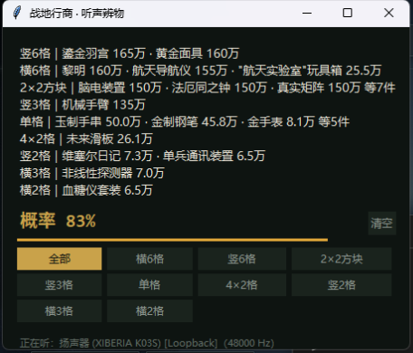

# 战地行商 · 听声辨物（Arena Merchant Listener）

实时监听扬声器正在播放的声音，认出《暗区突围》战地行商开箱时那一声拾取音属于哪一组物资，并告诉你这一组里符合当前格型的大金是哪些、单价多少、有多大把握。

纯本地运行：不联网、不上传音频、不读游戏内存、不注入进程、不改动游戏文件。它只是"听"你扬声器里的声音。



> 这是一个个人使用的原型工具，识别做得到「组」这一级，做不到「就是这一件」。下面「不能做什么」一节写清了边界，请先读完再用。

## 它做什么

- **检测拾取音事件**：通过 WASAPI 回环录制系统输出（`pyaudiowpatch`），不占用麦克风，不影响游戏，也不需要切窗口。
- **比对识别**：把抓到的波形与参考样本做归一化互相关（权重 0.85）+ 24 个对数频带音色余弦（权重 0.15），取最相似的一组，给出 0–100% 的相似度。
- **直接给结论**：小窗只显示两部分——「大金」按占格分行（横 6 格 / 竖 6 格 / 2×2 方块 / 单格 …），每件只写名字和单价；以及这一声的概率。
- **按格型筛选**：小窗底部一排按钮，点「横 6 格」屏幕上就只剩那一行，不用在几行里找。选择会记住。
- **设备可控**：窗底显示「正在听：<设备名>」，设备不对时用 `选输出设备.bat` 换掉。

## 它做不到什么（务必看清）

| 边界 | 说明 |
| --- | --- |
| 只到「组」 | 同一组内的物品共用同一段拾取音，占格不同的也听不出区别。只能「听声定组 → 看你拖动时的轮廓二次筛选」。 |
| 不报小件 | 默认只显示红货 + 金货（`BIG_MIN_RARITY = 5`）。紫、蓝、绿、白一律不显示。 |
| 会误判 | 相似度 < 0.45 的灰色结果是低可信。05、08 这种很"虚"的音偶尔会飘，重拖一次即可。 |
| 依赖样本 | 用的就是你喂给它的样本。样本质量决定准确率，见 `docs/准备声音样本.md`。 |
| 依赖声音 | 游戏音量太小、旁边开着微信/音乐/网页视频，都会干扰。 |

## 原理

1. **采集**：后台线程按真实节奏连续读回环缓冲（而不是按需读一块），持续写入极低幅度的静音保活；超过 20 秒全程无声时自动重开采集流，避免设备休眠后卡死。
2. **事件检测**：能量门限触发（`--sensitivity` 调 low/normal/high），每次事件截 1.45s 窗口并提前 60ms，避免切掉起音。
3. **比对**：一阶高通去低频轰鸣 → 降采样到 16kHz → 归一化互相关 + 音色频带余弦 → 取最高分。间隔 0.12s 一轮，`--light` 放宽到 0.24s，CPU 约减半。

## 安装

需要 Windows（WASAPI 回环仅 Windows 可用）、Python 3.10+。

```bash
pip install -r requirements.txt
```

`tkinter` 随 Windows 官方 Python 自带，不需要另装。

## 准备声音样本（必须先做，否则跑不起来）

**本仓库不附带游戏原声**，原因见 `NOTICE`。你需要自己准备 17 段参考样本，放到 `snd/`：

```
snd/snd01.wav   ← 对应 groups.json 里 id = 1 的那一组
snd/snd02.wav
…
snd/snd17.wav
```

要求：48kHz、16bit、单声道或双声道，每段只含一次拾取音。具体怎么录、怎么切、怎么验证，见 [`docs/准备声音样本.md`](docs/准备声音样本.md)。

样本缺失时程序会明确提示缺哪个文件，不会静默失败。

## 运行

双击 `启动.bat`（默认模式）或 `启动-省电.bat`（省 CPU，常驻玩游戏用这个），或者命令行：

```bash
python listen.py
```

小窗显示「等待拾取音…」即表示已在监听。关掉小窗 = 完全退出，不留后台进程。

### 选设备

```bash
python listen.py --list            # 列出所有可用的回环设备
python listen.py --device 耳机      # 按名称片段指定
```

也可以双击 `选输出设备.bat`，按序号选，程序会记住（写在 `记住的设备.txt`）。直接回车 = 恢复跟随系统默认输出。

## 参数

| 参数 | 作用 |
| --- | --- |
| `--device <片段>` | 指定回环设备名，如 `耳机`、`XIBERIA` |
| `--list` | 列出可用的回环设备 |
| `--light` | 省电模式，比对间隔 0.12s → 0.24s，CPU 约占一半 |
| `--sensitivity low/normal/high` | 触发门限。游戏音量小用 high，噪声大误报多时用 low |
| `--check` | 离线自检：17 段样本加噪声、改音量、移位各 3 次，打印命中率 |
| `--selftest-all` | 真播真录自检：把样本依次播出来再录回来核对，打印命中与错判清单 |
| `--boost` | 自检时使用 `snd_boost/` 里放大音量的副本 |
| `--record <文件>` | 调试：把采集到的声音存成 wav |
| `--verbose` | 打印每轮比对得分 |

## 自检

```bash
python listen.py --check          # 离线，开发者本机 51/51
python listen.py --selftest-all   # 真机播放，开发者本机 15–17/17（05/08 偶飘）
```

`--check` 不依赖声卡，适合改算法后回归；`--selftest-all` 才是贴近真实链路的验证。

## 目录结构

```
arena-merchant-listener/
├─ listen.py              主程序：采集 / 事件检测 / 比对 / 悬浮窗
├─ 选输出设备.py           设备选择小工具
├─ 启动.bat / 启动-省电.bat  双击启动
├─ 选输出设备.bat
├─ groups.json            17 组的元信息与统计（名称、件数、价位、稀有度、格型分布）
├─ 藏品占格原始.json       每件藏品的占格与参考价原始数据
├─ 物品对照表.txt          人读版：17 组 → 138 件藏品全文
├─ requirements.txt
├─ docs/
│  ├─ 使用说明.md         完整使用手册与常见问题
│  └─ 准备声音样本.md      自己录制样本的步骤
└─ snd/                  参考样本目录（默认不入库，见 .gitignore）
```

## 常见问题

**一直停在「等待拾取音…」**
先看窗底「正在听：<设备名>」是不是游戏声音实际走的那个设备。不对就跑 `选输出设备.bat`。系统长时间无声音会把音频设备休眠，第一声可能漏掉，再拖一次就正常。

**结果不稳 / 老是不出结果**
游戏音量别太小，系统音量保持正常。听的时候关掉微信、音乐、网页视频。

**弹出别的组**
看相似度和次选。相似度低于 0.45 的灰色结果不可信，重拖一次。

更多见 [`docs/使用说明.md`](docs/使用说明.md)。

## 许可

[Apache License 2.0](LICENSE) © 2026 zhenninghou221-afk

你可以自由使用、修改、商用、再分发，但必须保留 `LICENSE` 与 `NOTICE`；修改过的文件要注明已修改。第三方素材与数据的归属见 [`NOTICE`](NOTICE)。

## 数据来源与免责

物品名称、占格、参考价格整理自玩家社区公开的声音图鉴（ABI Builder / Maoyan 等站点）。原始数据版权归其权利人所有，本仓库仅引用公开事实。仓库不含任何游戏音频。

《暗区突围》《Arena Breakout》为腾讯 / MoreFun 的商标，本项目为个人非官方作品，与官方无关联。使用者应自行确认使用行为符合游戏用户协议与当地法律，作者不对使用后果负责。
